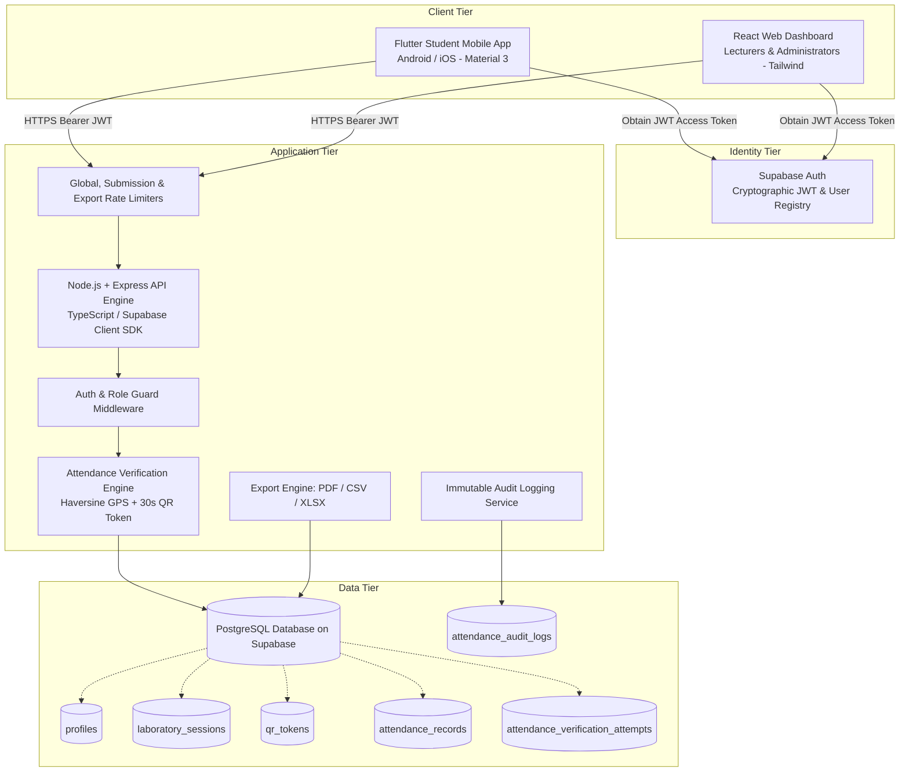
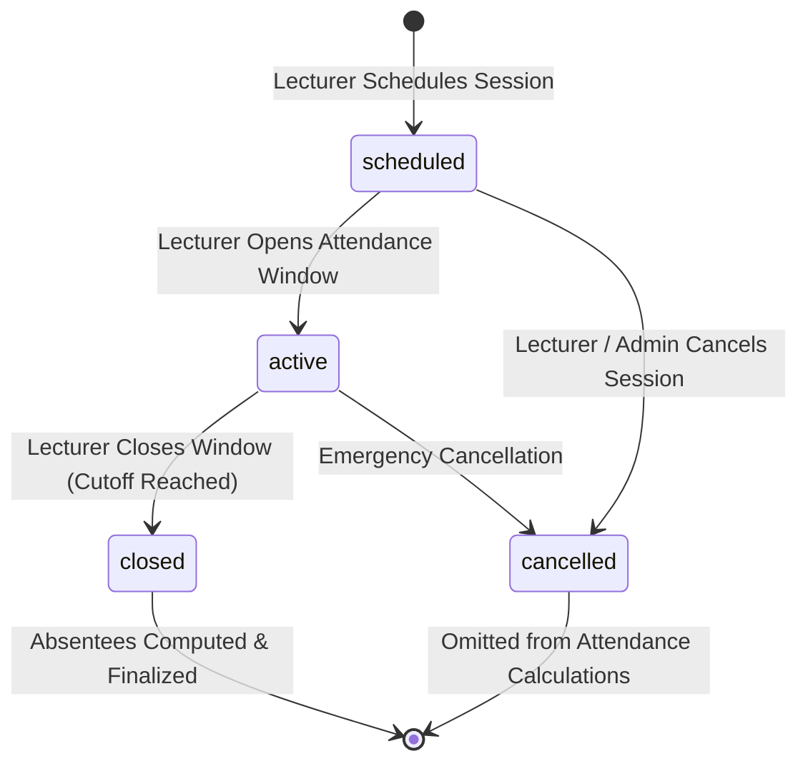
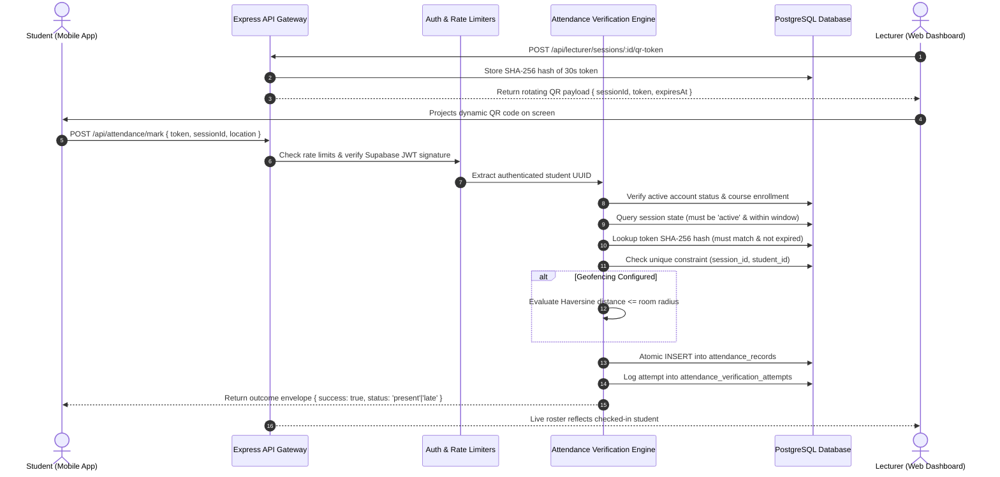

# AttendX System Architecture Blueprints

This document details the architectural design, component interactions, network topology, trust boundaries, and state machines of **AttendX**—the smart university attendance management system for NSBM Green University.

---

## 1. High-Level System Architecture

AttendX employs a multi-tier, zero-trust client architecture. Client applications (the Flutter mobile application for students and the React web dashboard for lecturers and administrators) authenticate against **Supabase Auth**, obtain short-lived cryptographic JWT tokens, and interact with the authoritative Node.js/Express API Gateway. The backend coordinates all business logic, Haversine proximity calculations, dynamic QR lifecycle rotation, and writes to a relational **PostgreSQL** database hosted on Supabase with Row-Level Security (RLS).

---

## 2. Component Directory Mapping

- [mobile/](file:///q:/MY%20Projects/AttendX/mobile): Flutter mobile application exclusively for students (Android/iOS) to scan dynamic QR codes, track personal attendance history, inspect module statistics, and verify exam eligibility against the 80% threshold.
- [web/](file:///q:/MY%20Projects/AttendX/web): React + TypeScript + Vite + Tailwind CSS dashboard for lecturers (to schedule sessions, project live 30-second rotating QR codes, inspect live rosters, and export reports) and administrators (to manage users, courses, terms, rooms, enrollments, and university-wide audit ledgers).
- [server/](file:///q:/MY%20Projects/AttendX/server): Node.js + Express + TypeScript API engine providing zero-trust validation, cryptographic QR token rotation, Haversine GPS proximity checking, and multi-format report generation.
- [database/](file:///q:/MY%20Projects/AttendX/database): PostgreSQL migrations, relational schemas, check constraints, foreign keys, and Row-Level Security (RLS) policies.
- [docs/](file:///q:/MY%20Projects/AttendX/docs): System specifications, architectural blueprints, database schemas, API references, security models, and testing manuals.

---

## 3. Session Lifecycle State Machine

A laboratory attendance session transitions through a deterministic state machine managed by assigned lecturers:

- **`scheduled`**: Session created with course, room coordinates, and planned time window. Students cannot mark attendance.
- **`active`**: Attendance window opened. Dynamic QR token generation activated (rotating every 30s). Students can submit attendance.
- **`closed`**: Window closed. All remaining dynamic tokens are revoked immediately. The system computes absent records for enrolled students who failed to submit attendance.
- **`cancelled`**: Session cancelled due to holiday or scheduling changes. Omitted from attendance quota formulas.

---

## 4. Attendance Submission & Verification Pipeline

When a student scans the projected QR code from the mobile client, the backend executes a rigorous 16-step verification pipeline:

---

## 5. Security & Trust Boundaries

1. **Client Untrusted**: All data originating from mobile devices (including GPS coordinates, timestamps, and tokens) are treated as untrusted input. The server derives the student's ID strictly from the verified Supabase JWT claim.
2. **Ephemeral QR Lifespan**: Dynamic tokens expire in 30 seconds, preventing proxy attendance via static photographs.
3. **Double-Scan Prevention**: Atomic database unique constraints `UNIQUE(session_id, student_id)` reject concurrent or replay submissions.
4. **Proximity Assurance**: Server-side Haversine calculations enforce maximum distance thresholds without exposing raw room coordinates to client devices.
