# AttendX Database Architecture & PostgreSQL Schema

## 1. Overview
AttendX operates on a relational PostgreSQL database hosted on **Supabase**. The schema guarantees data integrity via primary key UUIDs, foreign key relationships, strict check constraints, automated `updated_at` triggers, append-only immutability triggers, and database-level Row-Level Security (RLS) policies.

---

## 2. Mermaid Entity-Relationship Diagram

```mermaid
erDiagram
    auth_users ||--|| profiles : "identifies (1:1)"
    
    academic_years ||--o{ semesters : "contains"
    
    semesters ||--o{ course_enrollments : "valid for"
    semesters ||--o{ lecturer_course_assignments : "valid for"
    
    courses ||--o{ course_enrollments : "enrolled in"
    courses ||--o{ lecturer_course_assignments : "assigned to"
    courses ||--o{ laboratory_sessions : "hosts sessions for"
    
    profiles ||--o{ course_enrollments : "student enrolls"
    profiles ||--o{ lecturer_course_assignments : "lecturer teaches"
    profiles ||--o{ laboratory_sessions : "lecturer manages"
    profiles ||--o{ attendance_records : "student attends"
    profiles ||--o{ attendance_audit_logs : "actor logs"
    profiles ||--o{ attendance_verification_attempts : "student attempts"
    
    laboratory_rooms ||--o{ laboratory_sessions : "located in"
    
    laboratory_sessions ||--o{ qr_tokens : "generates rotating"
    laboratory_sessions ||--o{ attendance_records : "records attendance"
    laboratory_sessions ||--o{ attendance_audit_logs : "adjustments for"
    laboratory_sessions ||--o{ attendance_verification_attempts : "attempts for"
    
    attendance_records ||--o{ attendance_audit_logs : "audit history"

    profiles {
        uuid id PK "references auth.users(id)"
        text email UK
        text full_name
        text role "student | lecturer | admin"
        text identification_number UK
        text account_status "active | suspended | inactive"
        timestamptz created_at
        timestamptz updated_at
    }

    academic_years {
        uuid id PK
        text name UK
        date start_date
        date end_date
        boolean is_active
    }

    semesters {
        uuid id PK
        uuid academic_year_id FK
        int semester_number "1, 2, 3"
        text name
        date start_date
        date end_date
        boolean is_active
    }

    courses {
        uuid id PK
        text code UK
        text name
        text faculty
        int credits
    }

    course_enrollments {
        uuid id PK
        uuid student_id FK
        uuid course_id FK
        uuid semester_id FK
        text status "enrolled | dropped | completed"
        timestamptz enrolled_at
    }

    lecturer_course_assignments {
        uuid id PK
        uuid lecturer_id FK
        uuid course_id FK
        uuid semester_id FK
        boolean is_coordinator
        timestamptz assigned_at
    }

    laboratory_rooms {
        uuid id PK
        text code UK
        text name
        text building
        int floor
        numeric latitude "-90 to 90"
        numeric longitude "-180 to 180"
        numeric radius_meters "> 0"
        boolean is_active
    }

    laboratory_sessions {
        uuid id PK
        uuid course_id FK
        uuid lecturer_id FK
        uuid room_id FK
        text title
        text session_type "lecture | lab | tutorial | exam"
        date session_date
        timestamptz start_time
        timestamptz end_time
        timestamptz attendance_opens_at
        timestamptz attendance_closes_at
        text status "scheduled | active | closed | cancelled"
    }

    qr_tokens {
        uuid id PK
        uuid session_id FK
        text token_hash UK
        text nonce
        timestamptz issued_at
        timestamptz expires_at
        boolean is_revoked
    }

    attendance_records {
        uuid id PK
        uuid session_id FK
        uuid student_id FK
        timestamptz marked_at
        text status "present | late | absent | excused | needs_review"
        text verification_method "dynamic_qr | dynamic_qr_gps | manual_adjustment"
        numeric latitude
        numeric longitude
        numeric distance_meters
    }

    attendance_audit_logs {
        uuid id PK
        uuid record_id FK
        uuid session_id FK
        uuid actor_id FK
        text action "INSERT | UPDATE_STATUS | MANUAL_OVERRIDE | EXCUSE_ABSENCE | REVISE_RECORD"
        jsonb previous_state
        jsonb new_state
        text reason
        timestamptz created_at
    }

    attendance_verification_attempts {
        uuid id PK
        uuid session_id FK
        uuid student_id FK
        text submitted_token_hash
        text result "accepted | rejected_* | flagged_review"
        numeric submitted_lat
        numeric submitted_lon
        numeric computed_distance
        text failure_reason
        timestamptz attempted_at
    }
```



---

## 3. Database Table Definitions & Constraints

| Table Name | Primary Key | Critical Constraints | Purpose |
| :--- | :--- | :--- | :--- |
| **`profiles`** | `id UUID` (`auth.users`) | `role IN ('student', 'lecturer', 'admin')`, `account_status IN ('active', 'suspended', 'inactive')`, `UNIQUE(email)`, `UNIQUE(identification_number)` | Extended profile for authenticated users. Enforces role security trigger. |
| **`academic_years`** | `id UUID` | `CHECK (start_date < end_date)`, `UNIQUE(name)` | Academic years (e.g. `2026/2027`). |
| **`semesters`** | `id UUID` | `CHECK (start_date < end_date)`, `semester_number IN (1, 2, 3)`, `UNIQUE(academic_year_id, semester_number)` | Terms/semesters within academic years. |
| **`courses`** | `id UUID` | `UNIQUE(code)`, `CHECK (credits > 0)` | Academic courses/modules. |
| **`course_enrollments`** | `id UUID` | `UNIQUE(student_id, course_id)`, `status IN ('enrolled', 'dropped', 'completed')` | Student module enrollments. Prevents duplicate enrollments. |
| **`lecturer_course_assignments`** | `id UUID` | `UNIQUE(lecturer_id, course_id, semester_id)` | Formal lecturer module allocations. |
| **`laboratory_rooms`** | `id UUID` | `UNIQUE(code)`, `latitude BETWEEN -90 AND 90`, `longitude BETWEEN -180 AND 180`, `radius_meters > 0` | Lecture halls and laboratories with GPS geofence bounds. |
| **`laboratory_sessions`** | `id UUID` | `CHECK (start_time < end_time)`, `CHECK (attendance_opens_at < attendance_closes_at)`, `status IN ('scheduled', 'active', 'closed', 'cancelled')` | Scheduled class sessions with attendance verification windows. |
| **`qr_tokens`** | `id UUID` | `UNIQUE(token_hash)`, `CHECK (issued_at < expires_at)` | Rotating ephemeral 30-second tokens. |
| **`attendance_records`** | `id UUID` | `UNIQUE(session_id, student_id)`, `status IN ('present', 'late', 'absent', 'excused', 'needs_review')` | Authoritative single attendance record per student per session. |
| **`attendance_audit_logs`** | `id UUID` | `CHECK (length(trim(reason)) >= 5)`, append-only trigger prevents UPDATE & DELETE | Immutable audit log for lecturer adjustments. |
| **`attendance_verification_attempts`** | `id UUID` | `result IN ('accepted', 'rejected_*', 'flagged_review')` | Real-time scan attempts ledger with GPS logging. |

---

## 4. Row-Level Security (RLS) Policy Explanations

Row-Level Security is strictly enabled on **every single table** (`ALTER TABLE ... ENABLE ROW LEVEL SECURITY`).

### 1. `profiles`
- **`profiles_select_policy`**: Authenticated users can read their own profile (`id = auth.uid()`). Administrators can read all profiles. Lecturers can view student profiles enrolled in courses they teach.
- **`profiles_update_self`**: Users can update non-privileged profile data (such as avatar or display name). A dedicated trigger (`protect_profile_privileges`) raises an exception if a non-admin attempts to change their `role` or `account_status`.
- **`profiles_delete_admin`**: Only administrators can delete profile records.

### 2. `academic_years`, `semesters`, `courses`
- **SELECT**: All authenticated university users can view active academic periods and course catalogs.
- **INSERT / UPDATE / DELETE**: Strictly restricted to users with `admin` role.

### 3. `course_enrollments`
- **SELECT**: Students can view only their own enrolled courses (`student_id = auth.uid()`). Lecturers can view enrollments for courses they are assigned to teach. Admins can view all enrollments.
- **ALL (Modifications)**: Only administrators can modify official enrollment rosters.

### 4. `lecturer_course_assignments`
- **SELECT**: Lecturers can view their assigned teaching modules. Admins can view all assignments.
- **ALL (Modifications)**: Only administrators can assign or reassign lecturers to courses.

### 5. `laboratory_rooms`
- **SELECT**: Authenticated users can view active lecture halls and lab room geofence specifications.
- **ALL (Modifications)**: Only administrators can add or alter rooms and geofence coordinates.

### 6. `laboratory_sessions`
- **SELECT**: Students can view scheduled sessions for courses they are actively enrolled in. Lecturers can view sessions for modules they teach. Admins can view all sessions.
- **INSERT / UPDATE**: Lecturers assigned to the specific course can create and start sessions, or administrators.
- **DELETE**: Restricted to administrators or the assigning lecturer.

### 7. `qr_tokens` (Strict Client Lockdown)
- **Zero Client Policies**: **NO** SELECT, INSERT, UPDATE, or DELETE policies exist for `authenticated` or `anon` roles.
- Direct client access returns zero records / permission denied.
- Access is restricted exclusively to the backend Node.js API engine using the Supabase `service_role` key.

### 8. `attendance_records`
- **SELECT**: Students can view only their own attendance records (`student_id = auth.uid()`). Lecturers can view the full roster for sessions they host. Admins can inspect all university attendance records.
- **UPDATE**: Lecturers can perform authorized status corrections for their own sessions (with mandatory audit logging).
- **INSERT**: Handled by the backend API engine through the zero-trust verification pipeline.

### 9. `attendance_audit_logs` (Strict Client Lockdown & Append-Only)
- **Zero Client Policies**: Direct client reads and writes are completely blocked.
- **Append-Only Trigger**: The PostgreSQL trigger `enforce_append_only` physically raises an exception on any `UPDATE` or `DELETE` statement, ensuring an immutable audit trail even for administrative connections.
- **INSERT**: Performed exclusively by the server backend via `service_role` when adjustments are committed.

### 10. `attendance_verification_attempts`
- **SELECT**: Students can review their own scan attempt history and outcome codes. Lecturers can inspect the real-time attempt stream for their sessions. Admins can inspect all university attempts.
- **INSERT**: Populated exclusively by the backend verification engine.

---

## 5. How to Apply Migrations

> [!NOTE]
> Migration scripts are located in `database/migrations/` and have **not** been automatically executed against a remote database. Follow either Method A or Method B below to apply them.

### Method A: Via Supabase CLI (Recommended)

1. **Install Supabase CLI** (if not already installed):
   ```bash
   npm install -g supabase
   ```
2. **Link to your Supabase Project**:
   ```bash
   supabase login
   supabase link --project-ref <your-supabase-project-id>
   ```
3. **Push Migrations**:
   ```bash
   supabase db push
   ```
4. **Seed Development Data (Optional)**:
   ```bash
   supabase db execute --file database/seeds/01_dev_seed.sql
   ```

---

### Method B: Via Supabase Web Dashboard (SQL Editor)

1. Open your browser and navigate to the **[Supabase Dashboard](https://app.supabase.com)**.
2. Select your project and click on the **SQL Editor** tab in the left navigation sidebar.
3. Open and run the migration files in numerical order:
   - `database/migrations/00001_create_extensions_and_functions.sql` -> Click **Run**
   - `database/migrations/00002_create_profiles.sql` -> Click **Run**
   - `database/migrations/00003_create_academic_structure.sql` -> Click **Run**
   - `database/migrations/00004_create_laboratory_rooms_and_sessions.sql` -> Click **Run**
   - `database/migrations/00005_create_attendance_and_audit.sql` -> Click **Run**
   - `database/migrations/00006_create_indexes.sql` -> Click **Run**
   - `database/migrations/00007_enable_row_level_security.sql` -> Click **Run**
4. *(Dev environment only)*: Run `database/seeds/01_dev_seed.sql` to populate mock test accounts and classes.
